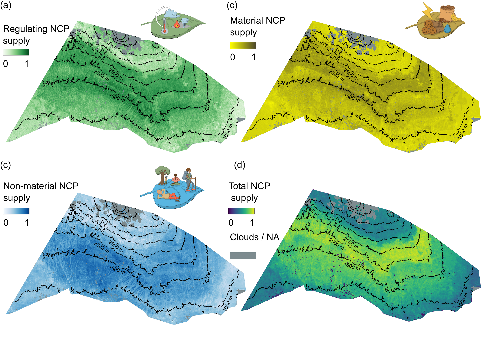

## Project description 
Synthesis – Kilimanjaro as an integrated Social-Ecological System. Learn more about the project [here](https://kili-ses.de/){:target="_blank"}.

## What are we aiming for?

Tropical mountains are a hotspot of biodiversity, cultural and linguistic diversity, but they face both anthropogenic and climate pressures. Such mountains usually have steep climatic gradients, high diversity of ecosystems and multiple stakeholder groups, thus they provide multiple NCPs, the supply and demand of which then become crucial to identify. 

Mount Kilimanjaro is one such unique tropical mountain. In this project, we quantitatively describe and integrate the major components of Kili Social-Ecological System and their interlinkages across the landscape. 

Conceptual social-ecological framework of Kili-SES. Subprojects (SPs) covering each area of the loop are shown in shaded boxes.
<em>Image</em>: [Kili-SES](https://kili-ses.de/project/conceptual-framework/){:target="_blank"} 

## What did we find?

In [Bhandari et al. (2026)](https://doi.org/10.1088/1748-9326/ae45bd){:target="_blank"}, we mapped the supply of 25 context-specific NCP across the southern slopes of Kilimanjaro, using 57 indicators from 60 plots and remote sensing data, upscaled with machine learning.

* NCP supply peaks at mid-elevations: the 1100–2800 m belt provides about 73% of total supply, especially in homegardens, coffee plantations, and lower montane and *Ocotea* forests.
* Coldspots occur at both ends of the gradient: maize fields and savanna in the lowlands, and *Erica* and *Helichrysum* vegetation at high elevations.
* Regulating, material and non-material NCP mostly show synergies, but these become weaker once climate is accounted for, showing how strongly climate shapes NCP supply.

Supply of a) regulating, b) non-material, c) material and d)total NCP across the southern slopes of Kilimanjaro.
<em>Image</em>: [Bhandari et al. (2026)](https://doi.org/10.1088/1748-9326/ae45bd){:target="_blank"}, Figure 4, [CC BY 4.0](https://creativecommons.org/licenses/by/4.0/){:target="_blank"}

The maps, data and code are openly available on [Zenodo](https://doi.org/10.5281/zenodo.17869262){:target="_blank"}. You will learn the methods behind these maps in the upscaling units of this course.

## What will the course deal with?

In this course, you will get a chance to work with real data and work with methods to upscale biodiversity (and NCP) from plot level data to landscape level and get an understanding of how social-ecological systems work. 

## Why upscale?

Landscape-wide data or upscaled data will help us understand different trade-offs and synergies between supply and demand of different NCPs. 
To understand better how trade-offs and synergies are dealt with, refer to [Manning et al 2018](https://www.nature.com/articles/s41559-017-0461-7){:target="_blank"}.

## Additional readings
* [Bhandari et al. 2026](https://doi.org/10.1088/1748-9326/ae45bd){:target="_blank"}