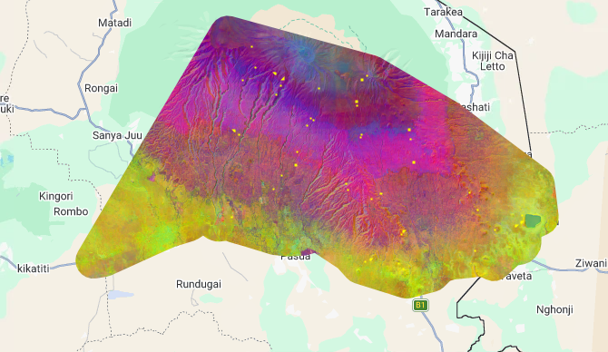
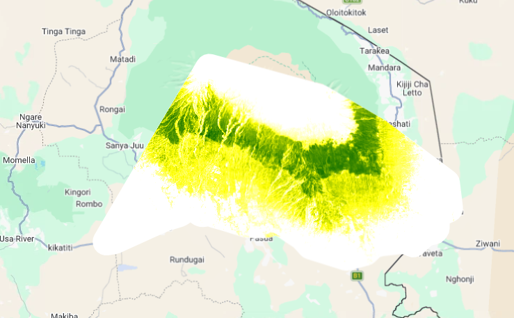

In this exercise, we load the AlphaEarth satellite embeddings for the southern slopes of Kilimanjaro, look at them on the map, and use them to find places that are similar to one of our plots. Finally, we check our results against the land-use map.

We go slowly: every step introduces only a few new commands, and each command is explained.

## Things you need for this exercise
* Your study area asset from the Sentinel-2 exercise (e.g. "study_area_kili")
* The plot shapefile `BPolygon.shp` from [Hessenbox](https://next.hessenbox.de/index.php/f/808342192){:target="_blank"}, folder "upscaling_data" → "vectors". Download all files that belong to it (`.shp`, `.shx`, `.dbf`, `.prj`, `.cpg`) and upload them as a GEE asset (e.g. "kili_plots"): "Assets" → "New" → "Shape files". The `.qmd` file is not supported by GEE; leave it out.
* The land-use map `VegAug1_KILI_SES.shp` from the same Hessenbox folder, uploaded as a GEE asset in the same way (e.g. "kili_landuse").
* The name of the dataset: "GOOGLE/SATELLITE_EMBEDDING/V1/ANNUAL" (read [here](https://developers.google.com/earth-engine/datasets/catalog/GOOGLE_SATELLITE_EMBEDDING_V1_ANNUAL){:target="_blank"})
{: .notice--info}

**Did you know?** You can comment out several lines at once in the GEE Code Editor: select them and press **Ctrl + /** (on a German keyboard, try **Ctrl + Shift + 7**). Press it again to undo.
{: .notice--success}


## Step 1: Load the embeddings

The dataset is an image collection with one image per year and tile. We filter it by year and study area and then merge the tiles into one image.

Choose the year that matches your plot data. Here we use 2022, the same year as our Sentinel-2 scene.

```js
// Replace with the paths of YOUR uploaded assets (see the Assets tab)
var studyArea = ee.FeatureCollection('projects/YOUR-PROJECT/assets/study_area_kili');
var plots = ee.FeatureCollection('projects/YOUR-PROJECT/assets/kili_plots');

// Load the satellite embeddings for the year 2022
var embeddings = ee.ImageCollection('GOOGLE/SATELLITE_EMBEDDING/V1/ANNUAL')
                   .filterDate('2022-01-01', '2023-01-01')  // the whole year 2022
                   .filterBounds(studyArea)                 // only images covering our study area
                   .mosaic()                                // join the tiles into one image
                   .clip(studyArea);                        // cut to the study area

// Look at the band names
print('Band names:', embeddings.bandNames());
```

Check the Console: you should see 64 bands, from `A00` to `A63`.

### What do these commands do?

| Command | What it does |
|---|---|
| `filterDate('2022-01-01', '2023-01-01')` | Keeps only images from 2022. The **end date is not included**, so "up to 1 January 2023" means the whole year 2022. To use another year, change both dates. |
| `filterBounds(studyArea)` | Keeps only images that overlap our study area. |
| `mosaic()` | The embeddings are stored in tiles, and our study area covers several of them. `mosaic()` stitches them into **one image**. |
| `clip(studyArea)` | Cuts the image to the outline of the study area, so only that part is shown and processed. |
| `print(...)` | Writes something into the **Console** tab, so you can check it. |


## Step 2: Display embeddings as an RGB image

We cannot look at 64 bands at once, but we can display any three of them as red, green, and blue.

```js
Map.centerObject(studyArea, 11);

// Show three embedding bands as RGB
var visParams = {min: -0.3, max: 0.3, bands: ['A01', 'A16', 'A09']};
Map.addLayer(embeddings, visParams, 'Embeddings (A01, A16, A09)');

// Add the plots on top
Map.addLayer(plots, {color: 'yellow'}, 'Plots');
```

`Map.addLayer(what, how, name)` adds a layer to the map: **what** to show, **how** to show it (bands, value range, colours), and the **name** in the Layers panel. Embedding values lie between −1 and 1; most are close to 0, so a range of −0.3 to 0.3 gives good contrast.

**The colours have no physical meaning.** Red is not "vegetation" and blue is not "water". Each of the 64 bands is an abstract feature that the model learned. Only the full set of 64 numbers carries information. What the colours *do* show is where places are similar (similar colour) or different (different colour).
{: .notice--warning}


<i>AlphaEarth embeddings for the southern slopes of Kilimanjaro, 2022, shown as RGB with bands A01, A16 and A09. Yellow dots: Kili-SES plots.</i>

### What do you see?

* The colours change in **bands parallel to the slope**: the embeddings follow the elevation zones of Kilimanjaro, from the lowland savanna and farmland, through the homegarden and coffee zone, to the forest belt and the high-altitude zones.
* The **river valleys** stand out as lines running down the slope.
* There are **no clouds**, because each embedding summarises a whole year of observations.

**Try it:**
1. Change the three bands, for example to `['A05', 'A30', 'A50']`. Which landscape features stand out now?
2. Add a true-colour Sentinel-2 image of 2022 (see the code below) and switch between the layers. Can you recognise the elevation zones of Kilimanjaro in both?
{: .notice--info}

```js
// Cloud-free Sentinel-2 true-colour image of 2022, for comparison
var s2_2022 = ee.ImageCollection('COPERNICUS/S2_SR_HARMONIZED')
                .filterDate('2022-01-01', '2023-01-01')
                .filterBounds(studyArea)
                .filter(ee.Filter.lt('CLOUDY_PIXEL_PERCENTAGE', 20)) // only images with little cloud
                .median()                                             // median removes remaining clouds
                .clip(studyArea);

Map.addLayer(s2_2022, {bands: ['B4', 'B3', 'B2'], min: 0, max: 3000}, 'Sentinel-2 2022 (true colour)');
```

<details markdown="1">
<summary><b>Show the answers</b></summary>

**1. Other bands:** the colours change completely, but the **same landscape patterns stay visible**: the forest belt, the farmland with its field patterns, the savanna, rivers and settlements. Different combinations highlight different boundaries, for example between forest and farmland, or inside the savanna. This shows again that a single band means nothing on its own.

**2. Comparison with Sentinel-2:**
* In the true-colour image, the **homegarden zone and the forest merge into one dark green band**. In the embeddings, they are clearly different colours.
* In the embeddings, the forest belt itself changes colour with altitude, which suggests differences between lower and upper forest. In true colour, it is almost uniform dark green.
* Sentinel-2 still shows **white cloud patches** in the upper zone, because Kilimanjaro creates its own clouds on most days. The embeddings have none.
* Sentinel-2 shows the landscape as a **median of one year's images**; the embedding is the **model's summary of the whole year** from many sensors.
</details>

**Did you know?** The `median()` of an image collection is also a **reducer**: for every pixel, it picks the middle value of all images. Clouds are very bright outliers, so they mostly disappear. You will meet reducers again in Step 3.
{: .notice--success}

The embedding doesn't show us something new that wasn't there. It shows the landscape we know, but more clearly separated, without clouds, and as a summary of the whole year. That's exactly what makes it useful as a predictor for upscaling: if similar places have similar embeddings, a model can learn that similar places also have similar biodiversity.


## Step 3: Similarity search

Now we use the embeddings to answer a simple question: **which places look like my plot?**

We do this in four small steps:
1. Pick one plot.
2. Calculate its mean embedding: its "fingerprint" of 64 numbers.
3. Calculate the dot product between this fingerprint and every pixel.
4. Show the result: high values mean "similar to my plot".

### 3a. Pick a reference plot

Here we use a lower montane forest plot, `flm1`.

```js
// Choose a reference plot (check the PlotID column of your asset)
var refPlot = plots.filter(ee.Filter.eq('PlotID', 'flm1')).first();
Map.addLayer(ee.FeatureCollection([refPlot]), {color: 'red'}, 'Reference plot');
```

Read the first line from left to right:

| Part | What it does |
|---|---|
| `plots` | The collection of **all** plots. |
| `ee.Filter.eq('PlotID', 'flm1')` | Builds a **rule**: keep only features whose `PlotID` **eq**uals `'flm1'`. Nothing is filtered yet. |
| `.filter(...)` | **Applies** the rule. The result is still a collection, now with only one plot in it. |
| `.first()` | Takes the **first feature** out of the collection: from "a collection with one plot" to "one single plot". |
| `var refPlot = ...` | Stores the plot under the name `refPlot`, so we can use it later. |

**Think of a shelf of folders:** `plots` is the whole shelf, `.filter(...)` pulls out all folders labelled "flm1", and `.first()` takes the one folder into your hand.

In R, the same step would be `plots[plots$PlotID == "flm1", ]`.

**Watch out:** the column name and the value must match **exactly**, including upper and lower case: `'PlotID'`, not `'plotid'`. If nothing matches, `.first()` returns nothing, and the next steps fail with an error. Check the column names with `print(plots.first());`.
{: .notice--warning}

**Did you know?** `ee.Filter.eq` has relatives: `ee.Filter.neq` (not equal), `ee.Filter.lt` (less than) and `ee.Filter.gt` (greater than). You already used `ee.Filter.lt('CLOUDY_PIXEL_PERCENTAGE', 20)` for the Sentinel-2 image.
{: .notice--success}

### 3b. Calculate the plot's fingerprint

```js
// Mean embedding of the reference plot
var bandNames = embeddings.bandNames();
var refVector = embeddings.reduceRegion({
  reducer: ee.Reducer.mean(),
  geometry: refPlot.geometry(),
  scale: 10
});

print('Fingerprint of the plot:', refVector);
```

A plot is 50 × 50 m, so it covers about **25 pixels** of 10 m, each with 64 values. We want **one** set of 64 values for the whole plot, so we take the average.

| Part | What it does |
|---|---|
| `reduceRegion` | "Reduce" means **summarise many values into one**. "Region" means: only inside a certain area. It works band by band, for all 64 bands. |
| `reducer: ee.Reducer.mean()` | **How** to summarise: take the average. Other options are `median()`, `min()` or `max()`. |
| `geometry: refPlot.geometry()` | **Where**: inside the plot outline. `.geometry()` takes the shape out of the plot feature. |
| `scale: 10` | The pixel size in metres for the calculation: the embeddings' own resolution. |

The result is not an image but a **dictionary**: a list of 64 name–value pairs (`A00: 0.031, A01: -0.112, ...`). Look at it in the Console.

**Filter or reducer?** A **filter selects**: it keeps some items and removes others, without changing them (picking apples from a fruit basket). A **reducer summarises**: it combines many values into fewer (making apple juice: many apples, one glass). We first filtered to find the plot, and now we reduce to summarise its pixels.
{: .notice--info}

<details markdown="1">
<summary><b>Why do we have to write <code>reducer:</code>, <code>geometry:</code> and <code>scale:</code>?</b></summary>

Inside curly braces `{ }`, every value needs its name, in the form `name: value`. The names must be spelled exactly as Earth Engine expects them. You can also leave out the braces and the names, but then the order must be right:

```js
embeddings.reduceRegion(ee.Reducer.mean(), refPlot.geometry(), 10);
```

Both versions do the same. The version with names is easier to read, and you cannot mix up the order. It is like `mean(x, na.rm = TRUE)` in R.
</details>

### 3c. Calculate the similarity (dot product)

```js
// Turn the fingerprint into a constant image with 64 bands
var refImage = refVector.toImage(bandNames);

// Dot product: multiply band by band and sum up
var similarity = embeddings.multiply(refImage)
                           .reduce(ee.Reducer.sum())
                           .rename('similarity');
```

This is exactly the dot product from the learning page, just with 64 numbers instead of 2:

| Part | What it does |
|---|---|
| `refVector.toImage(bandNames)` | Turns the fingerprint into an **image** in which every pixel has the plot's 64 values. `bandNames` keeps the bands in the same order (A00 to A63), so A05 is always compared with A05. |
| `embeddings.multiply(refImage)` | For every pixel: A00 × A00, A01 × A01, … A63 × A63. **"Multiply the matching numbers."** |
| `.reduce(ee.Reducer.sum())` | Adds up the 64 products into **one number per pixel**. **"Then add."** |
| `.rename('similarity')` | Gives the result band a clear name (otherwise it would be called `sum`). |

**Did you know?** Reducers can summarise in three directions. **Over time** (many images → one image): `.median()` in Step 2. **Over bands** (many bands → one band): `.reduce(ee.Reducer.sum())` here. **Over space** (many pixels → one value): `.reduceRegion(...)` in 3b.
{: .notice--success}

### 3d. Show the similarity map

```js
Map.addLayer(similarity,
             {min: 0.5, max: 1, palette: ['white', 'yellow', 'darkgreen']},
             'Similarity to reference plot');
```

The palette Colours show low similarity **white**, medium **yellow** and high **dark green**: **the darker, the more similar** to plot flm1.

**Why `min: 0.5`?** The mean of several pixels is slightly shorter than length 1, so even inside the plot the values stay a little below 1. Most values on the mountain are above 0.5, so starting the colour scale at 0.5 gives more contrast. Click on a few pixels with the **Inspector** to see the real values, and adjust `min` if needed.
{: .notice--info}


<i>Similarity to the lower montane forest plot flm1, 2022. Darker green = more similar.</i>

### What do you see?

**Look at the map before you open the answers.** Where are the most similar places? Do they follow the elevation zones of the mountain? Can you see anything along the rivers?
{: .notice--info}

<details markdown="1">
<summary><b>Show what the map tells us</b></summary>

* **A continuous dark green band around the mountain.** Plot flm1 is a lower montane forest, and the most similar places are exactly the **forest belt**. The model has "found" the forest without anyone telling it what forest is.
* **Green lines reaching down into the lower slopes.** These follow the **river valleys**. Strips of forest along the rivers look similar to the montane forest, even inside the farmland zone.
* **A mixed green-yellow zone below the forest belt.** This is the **homegarden and coffee zone**: partly similar to forest (many trees), but not the same.
* **Yellow in the lowlands and above the forest** (savanna, farmland, and the *Erica* and alpine zone): least similar to flm1.
* **A white patch at the eastern edge:** probably a water body. Water is very different from forest.

We gave the model **one plot**, and it showed us the whole forest belt, including the narrow forest strips in the valleys. That is the idea behind using embeddings for upscaling: if similar embeddings mean similar places, then a model trained on our plots can predict for places it has never seen.
</details>

**Try it:**
1. Repeat the search with the coffee plot `cof1`. Where are the most similar places now?
2. Try a homegarden plot (`hom1`) or a savanna plot (`sav1`). How does the green zone move?
3. Some dark green areas in the flm1 map are not natural forest. Can you find any? What could they be?
{: .notice--info}

<details markdown="1">
<summary><b>Show the answers</b></summary>

**1. Coffee plot cof1:** the similar areas **move down the mountain**, to the belt below the forest. The forest belt itself is now white, even though forest and coffee are both green and full of trees: the model separates them clearly. The pattern is **patchy**, not one solid band, because coffee grows in small plots mixed with homegardens, fields, houses and roads.

**2. Other plots:** the green zone moves to the **elevation band of that land use**: lowlands for savanna, the lower slopes for homegardens. Each land-use type has its own "fingerprint".

**3. Not natural forest:** for example **forest plantations** or **dense homegardens**. From space, they can look similar to a natural forest. This shows a limit of similarity: **similar from space does not always mean ecologically the same.**
</details>


## Step 4: Compare with the land-use map

The similarity map tells us which places *look* like our plot. But are these places really the same land-use type? To check, we compare the map with the land-use map of Kilimanjaro. We do this in four small steps.

### 4a. Load the land-use map

```js
// Replace with the path of YOUR uploaded land-use asset
var landuse = ee.FeatureCollection('projects/YOUR-PROJECT/assets/kili_landuse');

// Look at one polygon
print('First polygon:', landuse.first());
```

Open the **Console** and expand "First polygon" → "properties". Each polygon has a column called `grid_code`: a number that stands for its land-use class.

### 4b. Which classes are there?

```js
// List all class codes in the map
print('Class codes:', landuse.aggregate_array('grid_code').distinct().sort());
```

| Part | What it does |
|---|---|
| `aggregate_array('grid_code')` | Collects the `grid_code` of every polygon into one list. |
| `distinct()` | Removes duplicates, so each code appears once. |
| `sort()` | Puts the codes in order. |

The numbers mean:

| Code | Land-use class | Code | Land-use class |
|---|---|---|---|
| 0 | Snow, glacier | 12 | Podocarpus forest (FPO) |
| 1 | Agriculture / maize (MAI) | 13 | Subalpine tussock grassland |
| 2 | Savanna (SAV) | 14 | Homegarden (HOM) |
| 3 | Swamp | 15 | Helichrysum (HEL) |
| 4 | Overgrown / clearing | 16 | Ocotea forest (FOC) |
| 7 | Forest plantation | 17 | Bare rock |
| 9 | Riverine | 18 | Lower montane forest (FLM) |
| 10 | Upper montane *Erica excelsa* forest | 19 | Coffee (COF) |
| 11 | Subalpine *Erica* bushland | | |

**Note** The letters in brackets are the same as in the plot names: plot `flm1` lies in class 18 (FLM), plot `cof1` in class 19 (COF), plot `hom1` in class 14 (HOM).
{: .notice--success}

### 4c. Show only the class of your reference plot

Our reference plot `flm1` is a lower montane forest plot, so we show class **18**. We use the same filter as for the plot: `ee.Filter.eq` keeps only the polygons whose `grid_code` equals 18.

```js
// Keep only the lower montane forest polygons (grid_code 18)
var forest = landuse.filter(ee.Filter.eq('grid_code', 18));

// Draw only their outlines, so the similarity map stays visible underneath
Map.addLayer(forest.style({color: 'red', fillColor: '00000000', width: 1}),
             {}, 'Lower montane forest (land-use map)');
```

`.style(...)` sets how the polygons are drawn: red outlines (`color`), a line width of 1, and a **transparent** fill (`fillColor: '00000000'`, where the last two zeros mean "fully transparent").

**Try it:**
* Do the dark green areas of the similarity map lie inside the red outlines?
* Where does the similarity map show "similar" places **outside** the outlines? What could they be?
{: .notice--info}

**If the outlines do not appear:** in the Layers panel, make sure the outline layer is **above** the similarity map. And check the code number: if no polygon has that code, the layer is simply empty, without an error.
{: .notice--warning}

### 4d. Show all classes in colour (optional)

To see what lies outside the outlines, it helps to show the whole land-use map. We turn the polygons into an image and colour each class.

```js
// Turn the polygons into an image: each pixel gets the grid_code of its polygon
var landuseImage = ee.Image().byte().paint(landuse, 'grid_code').clip(studyArea);

// One colour for each code from 0 to 19
var palette = [
  'ffffff', 'f4e04d', 'd9b26f', '4fb3bf', 'c5c58f',  // 0–4
  '000000', '000000', '9ccc65', '000000', '00897b',  // 5–9 (5, 6, 8 are not used)
  '558b2f', 'a1887f', '33691e', 'dce775', 'ff9800',  // 10–14
  'd7ccc8', '2e7d32', '9e9e9e', '004d40', '8d4b2b'   // 15–19
];

Map.addLayer(landuseImage, {min: 0, max: 19, palette: palette}, 'Land-use map', false);
```

`paint()` "paints" each polygon into an empty image, using its `grid_code` as the pixel value. The last argument of `Map.addLayer`, `false`, adds the layer but switches it off. Switch it on in the **Layers** panel and compare it with the similarity map.

**Try it:**
1. Repeat the similarity search with the coffee plot `cof1`, and outline class **19** instead of 18. Do the similar places now match the coffee areas?
2. Coffee is often grown in homegardens. Outline class **14** as well. Does this explain some of the "similar" places outside the coffee areas?
{: .notice--info}

<details markdown="1">
<summary><b>Show the answers</b></summary>

**1.** Many of the dark green areas lie inside or close to the coffee outlines, but not all of them. The similarity map also marks places outside the mapped coffee areas.

**2.** Many of these places are **homegardens**, where coffee grows under bananas and shade trees. From space, a homegarden with coffee can look very similar to a coffee plantation. The land-use map separates them as two classes, but the embeddings see a gradual transition. This links back to the "mixed pixel" question from the hyperspectral unit.
</details>


## Step 5: Save your script

Save your script (e.g. "embeddings_kili"). We continue in the same script in the next exercise.

**Think back:** In this exercise you used one plot to find similar places on the whole mountain. In the upscaling units, a machine learning model will do the same with **all** plots at once: it learns how the embeddings relate to species richness, and predicts richness for every pixel.
{: .notice--info}

## Comments 

You can leave comments below if you have questions or remarks about any of the text or code in this unit. Please copy the corresponding line into your comment to make it easier to answer your questions.

<script src="https://utteranc.es/client.js" 
        repo="GeoMOER/moer-mpg-upscaling"
        issue-term="moer_mpg_upscaling_embeddings_Exploring" 
        theme="github-light" 
        crossorigin="anonymous" 
        async> 
</script> 
