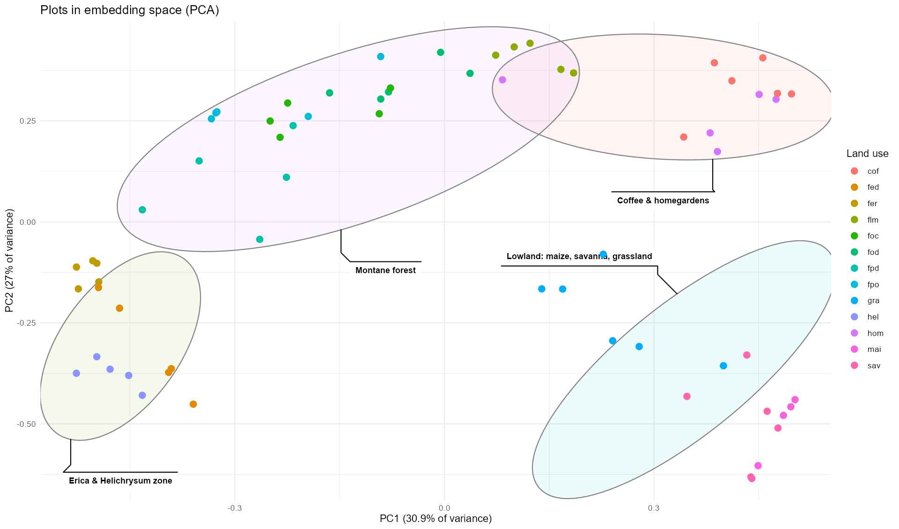

In this exercise, we extract the mean embedding for each Kilimanjaro plot, export it as a table, and take a first look at it in R. This table becomes an extra set of predictors for the upscaling workflow in Unit 08.

Along with the embeddings, we also extract two classic predictors, **NDVI** and **elevation**, so we can compare both kinds of data.

## Step 1: Extract the embeddings for all plots in GEE

Continue in the script from the previous exercise. There we calculated the fingerprint of **one** plot with `reduceRegion`. Now we do the same for **all** plots at once.

### 1a. Add NDVI and elevation

Each plot is 50 m × 50 m and covers about 25 embedding pixels. Before we average them, we add two classic predictors as extra bands, so everything is extracted in one go.

Elevation is easy. NDVI needs more care on Kilimanjaro:

Kilimanjaro's montane forest lies in a **cloud belt**: between about 2000 and 3000 m, it is cloudy on most days of the year. A normal median image of a year still contains many clouds there, and clouds have an NDVI close to 0. So we do it in three steps:

1. **Remove cloud pixels** in every image.
2. **Calculate NDVI** for every image.
3. **Keep the greenest values**: the 90th percentile of all NDVI values of the year.

```js
// 1. A function that removes cloud pixels from one Sentinel-2 image
function maskClouds(img) {
  var scl = img.select('SCL');                          // scene classification band
  var clear = scl.eq(4).or(scl.eq(5)).or(scl.eq(6));    // 4 = vegetation, 5 = bare soil, 6 = water
  return img.updateMask(clear);                         // everything else is hidden
}

// 2. A function that calculates NDVI for one image
function addNDVI(img) {
  return img.normalizedDifference(['B8', 'B4']).rename('NDVI');   // (NIR - Red) / (NIR + Red)
}

// 3. Peak-greenness NDVI of 2022
var ndvi = ee.ImageCollection('COPERNICUS/S2_SR_HARMONIZED')
             .filterDate('2022-01-01', '2023-01-01')
             .filterBounds(studyArea)
             .filter(ee.Filter.lt('CLOUDY_PIXEL_PERCENTAGE', 70))
             .map(maskClouds)                         // remove cloud pixels
             .map(addNDVI)                            // NDVI per image
             .reduce(ee.Reducer.percentile([90]))     // keep the greenest values
             .rename('NDVI');

Map.addLayer(ndvi, {min: 0, max: 0.9, palette: ['brown', 'yellow', 'green']}, 'NDVI p90');

// Elevation from the SRTM digital elevation model (30 m)
var elevation = ee.Image('USGS/SRTMGL1_003').rename('elevation');

// Put everything into one image: 64 embedding bands + NDVI + elevation
var predictors = embeddings.addBands(ndvi).addBands(elevation);
```

| Command | What it does |
|---|---|
| `img.select('SCL')` | Every Sentinel-2 surface reflectance image has a **Scene Classification Layer** (SCL). It labels each pixel, for example 4 = vegetation, 8 and 9 = cloud, 3 = cloud shadow. |
| `scl.eq(4).or(scl.eq(5)).or(scl.eq(6))` | `eq` = "equals". The result is 1 where the pixel is vegetation, bare soil or water, and 0 everywhere else. |
| `img.updateMask(clear)` | Hides all pixels where `clear` is 0, so clouds, shadows and snow are ignored in the next steps. |
| `.map(function)` | Applies a function to **every image** in the collection, one after another. |
| `CLOUDY_PIXEL_PERCENTAGE < 70` | We now allow cloudier scenes, because the cloud pixels are removed anyway. That leaves more clear pixels per location. |
| `.normalizedDifference(['B8', 'B4'])` | Calculates NDVI for every pixel, as in Unit 03. |
| `ee.Reducer.percentile([90])` | For every pixel, sorts all NDVI values of the year and takes the value that 90 % of them are below. This is the **peak greenness** of the year. Any clouds the mask missed have low NDVI and are ignored. |
| `ee.Image('USGS/SRTMGL1_003')` | Loads a global elevation model from the Earth Engine catalogue. It has one band, which we rename to `elevation`. |
| `.addBands(...)` | Adds the bands of another image. Our image now has 64 + 2 = 66 bands. |

**Why not simply `.median()`?** We tried that first. With a median image and a 20 % cloud filter, the forest plots got NDVI values of 0.03–0.3, which is unrealistic for a closed forest. The filter only removes very cloudy **scenes**; the clouds inside the remaining scenes stay. In the cloud belt, these clouds pulled the median down. Coffee plots below the cloud belt looked fine, which is a good hint that the problem was clouds and not the vegetation.
{: .notice--warning}

<details markdown="1">
<summary><b>Show the NDVI values we got with both methods</b></summary>

| Land use | Median NDVI: simple median | Median NDVI: cloud mask + 90th percentile |
|---|---|---|
| flm (lower montane forest) | 0.56 | 0.85 |
| foc (*Ocotea* forest) | 0.25 | 0.74 |
| fpo (*Podocarpus* forest) | 0.18 | 0.76 |
| cof (coffee) | 0.76 | 0.83 |
| sav (savanna) | 0.39 | 0.65 |
| hel (*Helichrysum*) | 0.06 | 0.12 |

The forest values changed the most. Notice that disturbed forest and disturbed *Erica* (fpd 0.69, fed 0.30) are now less green than the intact types (fpo 0.76, fer 0.53).
</details>

### 1b. Mean values for every plot

```js
// Mean of every band for every plot
var plotValues = predictors.reduceRegions({
  collection: plots,
  reducer: ee.Reducer.mean(),
  scale: 10
});

print('First plot:', plotValues.first());
```

| Part | What it does |
|---|---|
| `reduceRegions` | Like `reduceRegion` from the last exercise, but for **many areas at once**. Note the **s**: one region → one result; many regions → one result per region. |
| `collection: plots` | **Where**: in every plot. The result is the plot table with 66 new columns. |
| `reducer: ee.Reducer.mean()` | **How**: the average of all pixels inside each plot. |
| `scale: 10` | The pixel size in metres. Elevation (30 m) is resampled to 10 m for this. |

Look at the first plot in the Console: next to `PlotID`, it now has the columns `A00` to `A63`, `NDVI` and `elevation`.

### 1c. Export the table

```js
// The names of the 64 embedding bands, as a normal JavaScript list
var bands = embeddings.bandNames().getInfo();

// Export the table to Google Drive
Export.table.toDrive({
  collection: plotValues,
  description: 'kili_plot_embeddings_2022',
  folder: 'GEE_Folder',                           // your Google Drive folder name
  fileNamePrefix: 'kili_plot_embeddings_2022',
  fileFormat: 'CSV',
  selectors: ['PlotID', 'NDVI', 'elevation'].concat(bands)
});
```

| Part | What it does |
|---|---|
| `bandNames().getInfo()` | Gets the band names `A00` … `A63` as a normal list. `getInfo()` is needed because `selectors` expects a normal JavaScript list, not an Earth Engine list. |
| `description` / `fileNamePrefix` | The name of the task in the Tasks tab and of the file in your Drive. |
| `selectors` | Which columns to export, in this order. Without it, Earth Engine also exports the plot geometry and other columns we don't need. |
| `['PlotID', 'NDVI', 'elevation'].concat(bands)` | Joins two lists: our three column names plus the 64 band names. |

Go to the **Tasks** tab and click **Run**. When the task is finished, download the CSV file from your Google Drive into your project folder.

<details markdown="1">
<summary><b>Another way to build the band names: a loop</b></summary>

You may see this code in other scripts. It builds the same list without asking Earth Engine:

```js
var bands = [];
for (var i = 0; i < 64; i++) {             // repeat for i = 0, 1, … 63
  bands.push(i < 10 ? 'A0' + i : 'A' + i); // add a leading zero below 10: A05, but A23
}
```

`i < 10 ? 'A0' + i : 'A' + i` is a short if-else: "if i is smaller than 10, write A0 + i, otherwise A + i". In R, the same list is `sprintf("A%02d", 0:63)`.
</details>


## Step 2: Load the embeddings in R

```r
library(dplyr)
library(ggplot2)

emb <- read.csv("E:/upscaling_course_WS_26/kili_plot_embeddings_2022.csv")  # adjust the path

dim(emb)            # number of plots, number of columns (PlotID + NDVI + elevation + 64)
head(emb[, 1:6])

# the embedding columns
emb_cols <- grep("^A[0-9]{2}$", names(emb), value = TRUE)
length(emb_cols)    # should be 64

# check for plots without values (e.g. outside the dataset coverage)
sum(!complete.cases(emb[, emb_cols]))
```

| Part | What it does |
|---|---|
| `grep("^A[0-9]{2}$", names(emb), value = TRUE)` | Finds all column names that look like "A + two digits": `^` = start of the name, `A`, `[0-9]{2}` = exactly two digits, `$` = end of the name. So `A05` matches, but `PlotID` and `NDVI` do not. |
| `complete.cases(...)` | `TRUE` for rows without missing values. `sum(!...)` counts the rows **with** missing values. It should be 0. |


## Step 3: Do similar plots have similar embeddings?

### What is a PCA?

Each plot is described by 64 numbers. You can think of every plot as a point in a space with 64 axes, but we can only draw two or three axes.

A **principal component analysis (PCA)** rotates this space to find the **directions in which the plots differ most**:

* **PC1** (the first principal component) is the direction along which the plots are most spread out.
* **PC2** is the next most spread-out direction, at right angles to PC1, and so on, up to PC64.

Each principal component is a combination of all 64 bands. By plotting PC1 against PC2, we get the **best possible 2D picture** of how the plots relate to each other.

**Think of a shadow:** if you hold a 3D object up to a lamp, its shadow is a 2D picture of it. A PCA turns the object until the shadow shows as much of its shape as possible.
{: .notice--info}

### Why do we do a PCA here?

1. **To see the data.** 64 columns are impossible to look at; a PCA plot shows all plots at once.
2. **To check the embeddings.** If they capture the landscape well, plots of the same land-use type should lie close together.
3. **To find out how much information the 64 bands really contain.** Many bands vary together. The PCA tells us how many independent "directions" we actually need.

### Run the PCA

The first three letters of the PlotID tell us the land-use type (for example `cof` for coffee plantations or `flm` for lower montane forest).

```r
emb$landuse <- substr(emb$PlotID, 1, 3)   # e.g. "cof1" -> "cof"

pca <- prcomp(emb[, emb_cols])            # PCA of the 64 embedding columns
summary(pca)                              # how much variance does each axis explain?
```

### What does "variance explained" mean?

`summary(pca)` shows, for each axis, the **Proportion of Variance**: the share of all differences between the plots that lies along that axis. **Cumulative Proportion** adds them up. In our data:

| Axes | Variance | Cumulative | Meaning |
|---|---|---|---|
| PC1 | 30.9% | 30.9% | the biggest single difference between plots |
| PC2 | 27.0% | **57.9%** | a PC1–PC2 plot shows **58%** of all differences |
| PC1–PC6 | | 81.6% | six axes hold four-fifths |
| PC1–PC13 | | 95.0% | |
| PC14–PC64 | | 5.0% | the last 51 axes together hold almost nothing |

**What this tells us:**
* The 64 bands are **highly redundant** for our plots: 13 axes capture 95% of the differences.
* The 2D picture is a good but **incomplete** summary. Two plots that look close in it can still differ along PC3, PC4 and further axes.
* We have about 60 plots and 64 predictors. A model can easily **overfit** with so many predictors. Using the first 10–15 principal components instead of all 64 bands is one way to reduce that risk.

### Plot the plots in embedding space

To make the groups easier to see, we combine the land-use types into four zones and draw an ellipse around each zone. For this we use the package `ggforce`.

```r
# install.packages("ggforce")   # only once
library(ggforce)

# PCA scores of the plots, plus their land-use type
scores <- data.frame(pca$x[, 1:2], landuse = emb$landuse)

# group the land-use types into zones
scores <- scores |>
  mutate(zone = case_when(
    landuse %in% c("flm", "foc", "fod", "fpo", "fpd") ~ "Montane forest",
    landuse %in% c("fer", "fed", "hel")               ~ "Erica & Helichrysum zone",
    landuse %in% c("cof", "hom")                      ~ "Coffee & homegardens",
    landuse %in% c("mai", "sav", "gra")               ~ "Lowland: maize, savanna, grassland"
  ))

table(scores$zone, useNA = "ifany")   # every plot should have a zone (no NA)

# share of variance on each axis, for the axis labels
var_exp <- round(100 * summary(pca)$importance[2, 1:2], 1)

ggplot(scores, aes(PC1, PC2)) +
  geom_mark_ellipse(aes(fill = zone, label = zone),
                    alpha = 0.08, colour = "grey50",
                    expand = unit(3, "mm"), label.fontsize = 9,
                    con.cap = 0, show.legend = FALSE) +
  geom_point(aes(colour = landuse), size = 3) +
  labs(title = "Plots in embedding space (PCA)",
       x = paste0("PC1 (", var_exp[1], "% of variance)"),
       y = paste0("PC2 (", var_exp[2], "% of variance)"),
       colour = "Land use") +
  theme_minimal()
```

| Part | What it does |
|---|---|
| `pca$x[, 1:2]` | The position of every plot on PC1 and PC2 (its "scores"). |
| `case_when(...)` | Like a list of if-else rules: if the land use is one of these codes, the zone is "Montane forest", and so on. |
| `geom_mark_ellipse(...)` | Draws a labelled ellipse around the plots of each zone. |
| `geom_point(...)` | Draws the plots, coloured by land-use type. |

**Error `could not find function "from_theme"`?** Your `ggforce` is newer than your `ggplot2`. Update ggplot2 with `install.packages("ggplot2")` and restart R (Session → Restart R). If that does not help, replace the `geom_mark_ellipse(...)` lines with `stat_ellipse(aes(group = zone, fill = zone), geom = "polygon", alpha = 0.1, colour = "grey50")`, which needs no extra package.
{: .notice--warning}


<i>The Kilimanjaro plots in embedding space: the first two principal components of the 2022 AlphaEarth embeddings, coloured by land-use type.</i>

**Questions:**
* Do plots of the same land-use type group together?
* Which land-use types overlap? Does that make sense ecologically?
* What could PC1 and PC2 stand for? Look at which plots lie on the left and right, at the top and bottom.
{: .notice--info}

<details markdown="1">
<summary><b>Show what the plot tells us</b></summary>

* **Plots of the same land-use type group together**, and the groups form four zones: montane forests, the *Erica* and *Helichrysum* zone, coffee and homegardens, and the lowland maize, savanna and grassland plots.
* **Overlaps make sense ecologically:** coffee and homegardens lie close together (coffee is often grown in homegardens), and so do the different forest types. One homegarden plot lies next to the forest plots: probably a very tree-rich homegarden.
* **PC1 (left to right)** runs from the high-elevation plots (*Erica*, *Helichrysum*, montane forest) on the left to the lowland plots (farmland, savanna) on the right. It probably reflects the **elevation and climate gradient**.
* **PC2 (top to bottom)** runs from tree-covered plots (forests, coffee, homegardens) at the top to open vegetation (savanna, maize, grassland, *Helichrysum*) at the bottom. It probably reflects **tree cover or vegetation structure**.

This is an interpretation, not yet a proof. We test it in Step 4.
</details>


## Step 4: Embeddings vs. classic predictors

The CSV already contains NDVI and elevation for every plot. We now check whether the embeddings capture these known gradients.

```r
# add the classic predictors to the PCA scores (same row order as emb)
scores$NDVI      <- emb$NDVI
scores$elevation <- emb$elevation

# Does PC1 follow elevation? Does PC2 follow NDVI?
cor(scores$PC1, scores$elevation)
cor(scores$PC2, scores$NDVI)

ggplot(scores, aes(elevation, PC1, colour = zone)) +
  geom_point(size = 3) +
  theme_minimal() +
  labs(x = "Elevation (m)", y = "PC1", colour = "Zone")
ggsave("pc1_elevation.png", width = 7, height = 5, dpi = 150)

ggplot(scores, aes(NDVI, PC2, colour = zone)) +
  geom_point(size = 3) +
  theme_minimal() +
  labs(x = "NDVI", y = "PC2", colour = "Zone")
ggsave("pc2_ndvi.png", width = 7, height = 5, dpi = 150)

# correlation of each single embedding band with NDVI
cors <- sapply(emb_cols, function(b) cor(emb[[b]], emb$NDVI))

# the five bands with the strongest correlation (positive or negative)
head(sort(abs(cors), decreasing = TRUE), 5)
```

| Part | What it does |
|---|---|
| `cor(x, y)` | The correlation between two variables: close to 1 or −1 = strong relationship, close to 0 = no linear relationship. |
| `sapply(emb_cols, function(b) ...)` | Repeats the correlation for every one of the 64 bands and collects the results. |
| `sort(abs(cors), decreasing = TRUE)` | Sorts the bands by the strength of the correlation, ignoring the sign. |
| `ggsave(...)` | Saves the last plot as an image file. `width` and `height` are in inches. |


<i>PC1 of the embeddings plotted against the elevation of the plots.</i>


<i>PC2 of the embeddings plotted against the peak-greenness NDVI of 2022.</i>

**Questions:**
* Is PC1 strongly related to elevation, and PC2 to NDVI? Does that confirm the interpretation from Step 3?
* Is there a single band that strongly correlates with NDVI? What does that tell you, and what does it *not* tell you?
* What information might the embeddings contain that NDVI and elevation do not?
{: .notice--info}

<details markdown="1">
<summary><b>Show what PC1 and PC2 mean</b></summary>

Our results:

| | r | r² | Meaning |
|---|---|---|---|
| PC1 vs elevation | −0.96 | 0.92 | 92 % of the variation along PC1 is explained by elevation |
| PC2 vs NDVI | 0.77 | 0.60 | 60 % of PC2 is explained by NDVI; 40 % is something else |

`r²` is simply `r` squared: the share of the variation that one variable explains in the other.

**PC1 ≈ elevation.** The plots line up almost perfectly from the lowlands (≈ 1000 m) through coffee and montane forest up to the *Erica* and *Helichrysum* zone (≈ 4000 m). The model never received elevation data: it learned Kilimanjaro's vegetation belts from the satellite images alone. The minus sign has no meaning, because a PCA axis can point in either direction.

**PC2 ≈ greenness, but not only.** Greener plots tend to have a higher PC2. But look at NDVI ≈ 0.7: savanna plots have a low PC2 (about −0.4), while montane forest plots have a high PC2 (about +0.2). They are equally green, yet the embeddings separate them clearly. PC2 is better described as **closed, woody canopy vs. open vegetation**, information that NDVI alone cannot see.

This confirms the interpretation from Step 3.
</details>

<details markdown="1">
<summary><b>Show hints for the other questions</b></summary>

* Strong correlations like these show that the main axes of the embeddings reflect gradients we already know. That is an **indirect way to explain** what the embeddings capture, and a good answer to the reviewer question from the discussion.
* A single band can correlate strongly with NDVI. But that does **not** mean this band "is" NDVI or measures greenness. Bands have no physical meaning, and the same information is spread across many bands.
* Embeddings combine many sensors and a **whole year**: seasonal changes, radar information on structure and moisture, and LiDAR information on canopy height. A single NDVI value contains none of this.
</details>

**Did you know?** With a simple median image, our forest plots had NDVI values of 0.03–0.3 because of the cloud belt, but the embeddings separated the forest plots perfectly even then. AlphaEarth combines many images over the year and also uses **radar** (Sentinel-1), which sees through clouds. For cloudy mountains like Kilimanjaro, this is a real advantage over optical indices.
{: .notice--success}

**Did you know?** In the upscaling units, you will be able to compare three models: one with classic predictors (NDVI, elevation, …), one with embeddings only, and one with both. This exercise is the first step towards that comparison.
{: .notice--success}


## Step 5: Save the predictor table

Save the table so you can use it in the upscaling workflow in Unit 08.

```r
write.csv(emb[, c("PlotID", "NDVI", "elevation", emb_cols)],
          "plot_embeddings_2022.csv", row.names = FALSE)
```

<i>The AlphaEarth Foundations Satellite Embedding dataset is produced by Google and Google DeepMind.</i>

## Comments 

You can leave comments below if you have questions or remarks about any of the text or code in this unit. Please copy the corresponding line into your comment to make it easier to answer your questions.

<script src="https://utteranc.es/client.js" 
        repo="GeoMOER/moer-mpg-upscaling"
        issue-term="moer_mpg_upscaling_embeddings_Extracting" 
        theme="github-light" 
        crossorigin="anonymous" 
        async> 
</script> 
