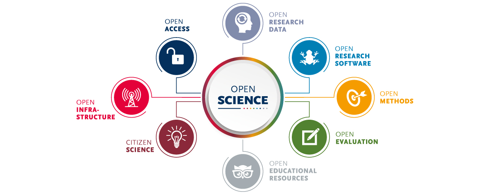

In this part, you will learn what open science is, which principles guide it, and how you can practice it.

## What is open science?

Open science is the practice of making scientific research and its dissemination accessible to all, regardless of expertise level.
This movement promotes transparency and collaborative work by encouraging the sharing of publications, data, physical samples, and software openly. 
Key aspects of open science include advocating for open access to research publications, practicing open-notebook science, which involves the open sharing of data and code, and engaging a broader audience in the scientific process. 
The goal is to facilitate easier publication, access, and communication of scientific knowledge, fostering a more inclusive and collaborative scientific community.

[Image source](https://images.app.goo.gl/HpHJxQZ2Kbnmi3PeA)

## Open data
Open data refers to information that is available for anyone to access, utilize, and distribute.
In other words ["Open data is data that can be freely used, re-used and redistributed by anyone - subject only, at most, to the requirement to attribute and sharealike."](https://opendatahandbook.org/guide/en/what-is-open-data/)
This data can be used by governments, businesses, and individuals to drive social, economic, and environmental benefits.

Sources of open data include:

1. Data repositories such as [Zenodo](https://zenodo.org/), [Figshare](https://figshare.com/), [PANGAEA](https://www.pangaea.de/), and [GBIF](https://www.gbif.org/).
1. Global institutions such as the [Food and Agriculture Organization](https://www.fao.org/faostat/en/#home) and the [World Bank](https://data.worldbank.org/).
1. Geospatial data services such as [OpenStreetMap](https://www.openstreetmap.org/), [Google Earth Engine](https://developers.google.com/earth-engine/datasets), [DIVA-GIS](https://diva-gis.org/), [Humanitarian OSM](https://www.hotosm.org/), [NASA Earthdata](https://www.earthdata.nasa.gov/), and the [Copernicus Data Space Ecosystem](https://dataspace.copernicus.eu/).
1. Social and environmental datasets formerly provided by SEDAC, now available through [NASA Earthdata Search](https://search.earthdata.nasa.gov/).

### FAIR data 
The FAIR data principles are guidelines to ensure that data are Findable, Accessible, Interoperable, and Reusable. These principles aim to make data easy to locate, obtain, and use for various purposes, and to be compatible with other datasets and tools for analysis.

- **Findable:** Easy for people and computers to discover.
- **Accessible:** Available under clearly defined conditions.
- **Interoperable:** Easy to integrate and share across platforms.
- **Reusable:** Documented so that others can reuse the data.

Read in detail about the FAIR principles [here](https://www.go-fair.org/fair-principles/)

## Collaborating and sharing your knowledge

- GitHub and GitLab
- Quarto
- Google Colab

## Open Science Framework

[Open science framework](https://youtu.be/X07mBq2tnMg?si=_7PbiZl_87h1zH6E)
